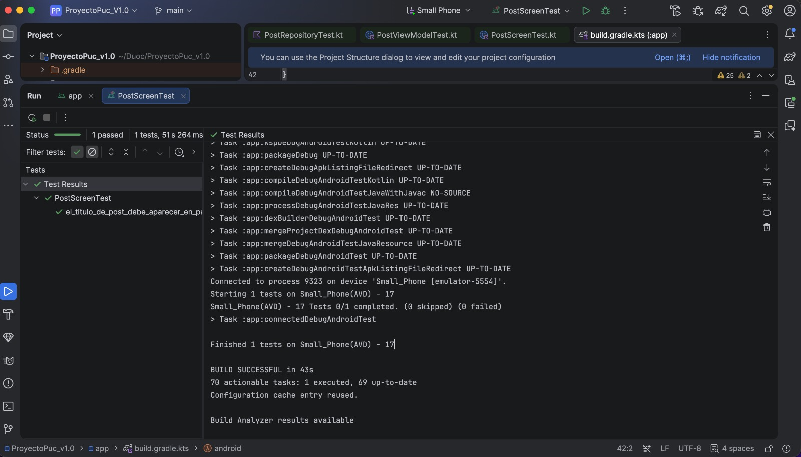
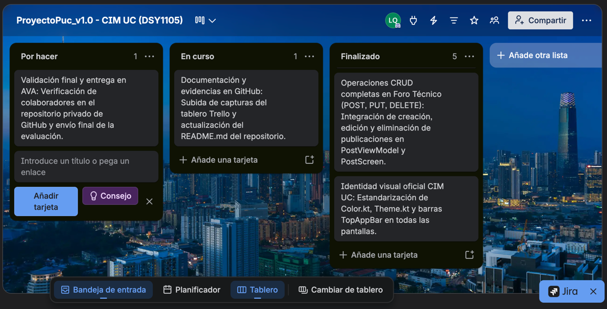

# CIM UC - App de Vinculación e Innovación en Madera

Aplicación Android nativa desarrollada en **Kotlin** y **Jetpack Compose** para el **Centro UC de Innovación en Madera (CIM UC)**.
La plataforma permite gestionar sesiones de investigadores, explorar proyectos y capacidades I+D destacadas sincronizadas en la nube, participar en un foro técnico conectado a una API REST externa y administrar el perfil de usuario mediante persistencia local.

Este proyecto evoluciona desde las evaluaciones **Parcial 2 y Parcial 3** (Guía 14 - *Consumiendo una API Rest* y Guía 15 - *Pruebas Automatizadas en Jetpack Compose*) hasta la **Evaluación Parcial 4 / Examen Final Transversal (EFT)** de la asignatura **Desarrollo de Aplicaciones Móviles (DSY1105)**, incorporando integración con **microservicio propio en Spring Boot desplegado en Render**, pruebas unitarias de sincronización y generación de **APK firmado (`release`)**.

---

## Contexto de la Problemática y Solución (Caso EFT - CIM UC)

El **Centro de Innovación en Madera de la Pontificia Universidad Católica de Chile (CIM UC)** desarrolla proyectos de investigación aplicada, normativas sísmicas y transferencia tecnológica en construcción sustentable. Sin embargo, la información de proyectos activos, líderes de investigación y publicaciones técnicas suele encontrarse dispersa en portales estáticos difíciles de consultar en terreno o desde dispositivos móviles.

**Solución implementada:**
Una aplicación móvil nativa que centraliza y sincroniza en tiempo real:
- **Catálogo de Proyectos I+D en la Nube:** Conectado a un microservicio REST propio desarrollado en **Spring Boot (Java 21)** desplegado mediante **Docker en Render**, respaldado con caché local en **SQLite (Room)** para operación offline.
- **Foro Técnico y Publicaciones Externas:** Consumo CRUD completo de APIs REST externas mediante **Retrofit + Gson**.
- **Gestión de Investigadores:** Registro, autenticación con validaciones reactivas, perfil con cámara/galería y persistencia de preferencias con **DataStore**.

---

## Identidad Visual e Interfaz
El diseño de la aplicación respeta la paleta cromática e identidad institucional de la plataforma web oficial del **CIM UC**:
- **Azul Institucional / Primario (`#1F4E9E`)**: Utilizado en barras superiores (`TopAppBar`), botones de acción, íconos y acentos principales.
- **Azul Claro UC (`#E8EFFA`)**: Aplicado en tarjetas de bienvenida de sesión y contenedores destacados.
- **Amarillo Acento (`#F5B800`)**: Destacado para etiquetas de áreas temáticas I+D y elementos decorativos institucionales.
- **Gris de Fondo (`#F8F9FA`) y Superficies (`#F1F4F9`)**: Proporcionan un entorno visual limpio e industrial alineado con el portal web.

---

## Arquitectura y Patrones (MVVM + Microservicios)
El proyecto implementa el patrón **Model-View-ViewModel (MVVM)** con estrategia *Single Source of Truth*, asegurando un desacoplamiento efectivo entre la lógica de negocio, la persistencia local, la red y la interfaz de usuario:

    +-------------------------------------------------------------------+
    |                   APLICACIÓN ANDROID (Kotlin / Compose)           |
    |                                                                   |
    |  [UI Screens] ---> [ViewModels (StateFlow)] ---> [Repositories]   |
    |                                                    |         |    |
    |                          +-------------------------+         |    |
    |                          v                                   v    |
    |               [Room DB / DataStore]             [RetrofitInstance]|
    |                 (Caché Offline)                   |          |    |
    +---------------------------------------------------|----------|----+
                                                        |          |
                             +--------------------------+          |
                             v                                     v
            +---------------------------------+   +------------------------------+
            | Microservicio Propio (Render)   |   | API Externa (JSONPlaceholder)|
            | Spring Boot 4.2 + Java 21 + H2  |   | Consumo de Posts y Noticias  |
            | https://cimuc-api.onrender.com  |   | jsonplaceholder.typicode.com |
            +---------------------------------+   +------------------------------+

### Estructura de Paquetes
- **`data/`**:
    - **`local/`**: Base de datos local SQLite mediante **Room** (`AppDatabase`, `UsuarioEntity`, `UsuarioDao`, `ProyectoEntity`, `ProyectoDao`) y preferencias con **DataStore** (`EstadoDataStore`).
    - **`remote/`**: Clientes HTTP **Retrofit** (`RetrofitInstance`, `ApiService` para JSONPlaceholder y `CimucApiService` con timeout extendido de 60s para Render).
    - **`PostRepository.kt` / `ProyectoRepository.kt`**: Repositorios para sincronización bidireccional entre el microservicio Spring Boot y Room.
- **`model/`**: Modelos de datos inmutables, DTOs remotos y estados de UI (`Post`, `ProyectoCim`, `ProyectoRemoto`, `FormularioUiState`, `FormularioErrores`).
- **`viewmodel/`**: Lógica de presentación y gestión de estado reactivo con `StateFlow` (`AuthViewModel`, `PostViewModel`, `PerfilViewModel`, `UsuarioViewModel`, `ProyectoViewModel`, `EstadoViewModel`).
- **`ui/`**:
    - **`components/`**: Componentes reutilizables de Jetpack Compose (`CampoText`, `AceptarTerminos`, `TarjetaProyecto`, `ImagenInteligente`).
    - **`screens/`**: Flujo completo de navegación (`LoginScreen`, `InicioScreen`, `CrearUsuarioScreen`, `PantallaPrincipal`, `DetalleProyectosScreen`, `PostScreen`, `PerfilScreen`, `AppNavigation`).
    - **`theme/`**: Configuración global de Material Design 3 (`Color.kt`, `Theme.kt`, `Type.kt`).
- **`test/` & `androidTest/`**:
    - **`test/`**: Pruebas unitarias de repositorio y ViewModel (`PostRepositoryTest`, `PostViewModelTest`, `ProyectoRepositoryTest`).
    - **`androidTest/`**: Pruebas instrumentadas de interfaz gráfica (`PostScreenTest`).

---

## Funcionalidades Principales

1. **Autenticación y Registro con Persistencia Local (`LoginScreen` + `CrearUsuarioScreen`)**:
    - Inicio de sesión con validación de credenciales y sesión activa en `AuthViewModel`.
    - Creación de cuentas nuevas con alerta de confirmación y almacenamiento automático en **Room Database**.

2. **Panel Principal Institucional (`InicioScreen`)**:
    - Dashboard centralizado con saludo dinámico al usuario autenticado y acceso directo a los módulos de Proyectos I+D, Foro Técnico y Edición de Perfil.

3. **Catálogo de Proyectos I+D Sincronizado con Microservicio (`PantallaPrincipal` + `DetalleProyectosScreen`)**:
    - Sincronización automática con el microservicio Spring Boot (`https://cimuc-api.onrender.com/api/proyectos`) y respaldo local en Room.
    - Despliegue dinámico mediante `LazyColumn`, vista de detalle ampliado y creación de nuevos proyectos sincronizados en la nube.

4. **Foro Técnico - Consumo API REST Externa (`PostScreen`)**:
    - Integración con `https://jsonplaceholder.typicode.com/posts` utilizando **Retrofit 2**, **Gson** y **Corrutinas**.
    - Operaciones **CRUD completas** en tiempo real: listar publicaciones (**GET**), crear nuevos aportes (**POST**), editar existentes (**PUT**) y eliminar publicaciones (**DELETE**) con retroalimentación mediante `Snackbar`.

5. **Perfil de Usuario/Investigador (`PerfilScreen`)**:
    - Edición y actualización persistente de datos personales en **Room** (`PerfilViewModel`).
    - Captura y previsualización de fotografía mediante integración nativa con **Cámara** y **Galería**.

---

## Endpoints Integrados

### A. Microservicio Propio (Spring Boot 4.2 + Java 21 + Docker en Render)
- **URL Base Producción:** `https://cimuc-api.onrender.com/`
- **Repositorio Backend:** [https://github.com/luhussdev/cimuc-api](https://github.com/luhussdev/cimuc-api)

| Método HTTP | Endpoint | Descripción |
| :--- | :--- | :--- |
| `GET` | `/api/proyectos` | Obtiene la lista completa de proyectos de investigación del CIM UC. |
| `GET` | `/api/proyectos/{id}` | Consulta el detalle de un proyecto específico por su ID. |
| `POST` | `/api/proyectos` | Registra un nuevo proyecto I+D en el microservicio y sincroniza localmente. |
| `PUT` | `/api/proyectos/{id}` | Actualiza los datos de un proyecto existente. |
| `DELETE` | `/api/proyectos/{id}` | Elimina un proyecto del catálogo remoto y local. |

### B. API Externa (Consumo REST)
- **URL Base:** `[https://jsonplaceholder.typicode.com/](https://jsonplaceholder.typicode.com/)`
- **Endpoints:** `GET /posts`, `POST /posts`, `PUT /posts/{id}`, `DELETE /posts/{id}`.

---

## Tecnologías y Librerías

- **Móvil:** Kotlin, Jetpack Compose (Material Design 3), Navigation Compose, Room Database, Preference DataStore, Coil.
- **Red y Concurrencia:** Retrofit 2 (`2.11.0`), OkHttp3, Converter Gson, Corrutinas de Kotlin y `StateFlow`.
- **Backend (Microservicio):** Spring Boot `4.2.0`, Java `21`, Spring Data JPA, H2 Database, Docker, Render Cloud.
- **Testing Automatizado:** Kotest (`5.8.0`), MockK (`1.13.10`), JUnit 5, `kotlinx-coroutines-test` y Compose UI Test (`ui-test-junit4`).
- **Gestión Colaborativa y Despliegue:** Git, GitHub, Trello y Firma Digital APK (`KeyStore .jks`).

---

## Pruebas Automatizadas (Guía 15 & Parcial 4)

Se implementó una estrategia de validación híbrida bajo arquitectura MVVM para garantizar la estabilidad de la capa de datos, estado, integración con microservicios y componentes visuales:

- **Pruebas Unitarias (`app/src/test/`)**:
    - `ProyectoRepositoryTest`: Verificación de sincronización remota desde el microservicio Spring Boot en Render hacia Room, tolerancia a errores/timeouts de red y creación remota de proyectos mediante **Kotest** (`StringSpec`) y **MockK**.
    - `PostRepositoryTest`: Verificación de obtención de datos desde `ApiService` simulado mediante **MockK** y aserciones con **Kotest**.
    - `PostViewModelTest`: Validación de carga reactiva en `StateFlow` mediante `kotlinx-coroutines-test` (`StandardTestDispatcher`).
- **Pruebas de Interfaz (`app/src/androidTest/`)**:
    - `PostScreenTest`: Validación de renderizado de tarjetas y títulos de publicaciones en **Jetpack Compose** mediante `createComposeRule()`.

### Evidencia de Ejecución

#### Pruebas Unitarias (Kotest + MockK)

#### Prueba de Interfaz (Compose UI Test)

---

## Firma Digital y APK de Producción (`Release`)

- **Artefacto generado:** `app/release/app-release.apk`
- **Firma criptográfica:** Firmado mediante llave privada RSA 2048-bit (`KeyStore .jks`) con esquemas **V1 (JAR Signature)** y **V2 (APK Signature Scheme)** para instalación directa en dispositivos físicos Android (`minSdk 24` / `targetSdk 37`).

---

## Gestión Colaborativa (Trello & GitHub)

El seguimiento de tareas del equipo se gestionó mediante metodología Kanban en **Trello** con las columnas *Por hacer*, *En curso* y *Finalizado*:

- **Tablero Trello:** [https://trello.com/b/25nW8PtJ/proyectopucv10-cim-uc-dsy1105](https://trello.com/b/25nW8PtJ/proyectopucv10-cim-uc-dsy1105)
- **Evidencia de planificación:**

---

## Instalación y Ejecución

1. Clonar el repositorio:

       git clone [https://github.com/luhussdev/ProyectoPuc_v10.git](https://github.com/luhussdev/ProyectoPuc_v10.git)

2. Abrir el proyecto en **Android Studio** (Ladybug o superior) y sincronizar Gradle.
3. Ejecutar en un emulador o dispositivo físico (`minSdk 24`), o instalar directamente el paquete firmado ubicado en `app/release/app-release.apk`.