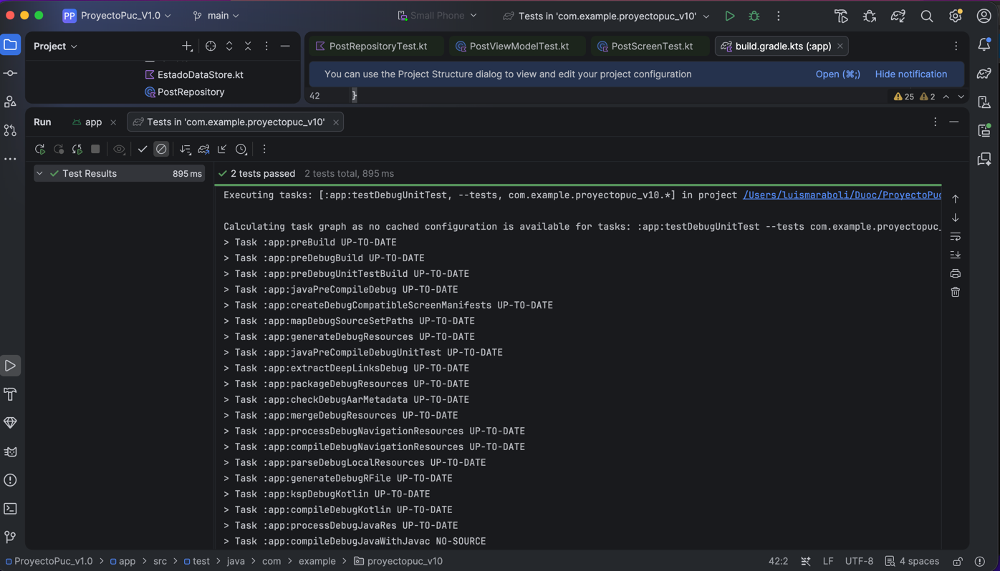

# CIM UC - App de Vinculación e Innovación en Madera

Aplicación Android nativa desarrollada en **Kotlin** y **Jetpack Compose** para el **Centro UC de Innovación en Madera (CIM UC)**.
La plataforma permite gestionar sesiones de investigadores, explorar proyectos y capacidades I+D destacadas, participar en un foro técnico conectado a una API REST externa y administrar el perfil de usuario mediante persistencia local.

Este proyecto forma parte de las evaluaciones **Parcial 2 y Parcial 3** (Guía 14 - *Consumiendo una API Rest* y Guía 15 - *Pruebas Automatizadas en Jetpack Compose*) de la asignatura **Desarrollo de Aplicaciones Móviles (DSY1105)**, cumpliendo estrictamente con los lineamientos de arquitectura limpia, calidad de software y trabajo colaborativo.

---

## Identidad Visual e Interfaz
El diseño de la aplicación respeta la paleta cromática e identidad institucional de la plataforma web oficial del **CIM UC**:
- **Azul Institucional / Primario (`#1F4E9E`)**: Utilizado en barras superiores (`TopAppBar`), botones de acción, íconos y acentos principales.
- **Azul Claro UC (`#E8EFFA`)**: Aplicado en tarjetas de bienvenida de sesión y contenedores destacados.
- **Amarillo Acento (`#F5B800`)**: Destacado para etiquetas de áreas temáticas I+D y elementos decorativos institucionales.
- **Gris de Fondo (`#F8F9FA`) y Superficies (`#F1F4F9`)**: Proporcionan un entorno visual limpio e industrial alineado con el portal web.

---

## Arquitectura y Patrones (MVVM)
El proyecto implementa el patrón **Model-View-ViewModel (MVVM)** asegurando un desacoplamiento efectivo entre la lógica de negocio, la persistencia de datos y la interfaz de usuario:

- **`data/`**:
    - **`local/`**: Base de datos local SQLite mediante **Room** (`AppDatabase`, `UsuarioEntity`, `UsuarioDao`, `ProyectoEntity`, `ProyectoDao`) y preferencias con **DataStore**.
    - **`remote/`**: Cliente HTTP **Retrofit** (`ApiService`, `RetrofitInstance`) conectado a JSONPlaceholder.
    - **`PostRepository.kt` / `ProyectoRepository.kt`**: Repositorios para el acceso unificado a datos remotos y locales.
- **`model/`**: Modelos de datos inmutables y estados de UI (`Post`, `ProyectoCim`, `FormularioUiState`, `FormularioErrores`).
- **`viewmodel/`**: Lógica de presentación y gestión de estado reactivo con `StateFlow` (`AuthViewModel`, `PostViewModel`, `PerfilViewModel`, `UsuarioViewModel`, `ProyectoViewModel`, `EstadoViewModel`).
- **`ui/`**:
    - **`components/`**: Componentes reutilizables de Jetpack Compose (`CampoText`, `AceptarTerminos`, `TarjetaProyecto`, `ImagenInteligente`).
    - **`screens/`**: Flujo completo de navegación (`LoginScreen`, `InicioScreen`, `CrearUsuarioScreen`, `PantallaPrincipal`, `PostScreen`, `PerfilScreen`, `AppNavigation`).
    - **`theme/`**: Configuración global de Material Design 3 (`Color.kt`, `Theme.kt`, `Type.kt`).
- **`test/` & `androidTest/`**:
    - **`test/`**: Pruebas unitarias de repositorio y ViewModel (`PostRepositoryTest`, `PostViewModelTest`)[cite: 12].
    - **`androidTest/`**: Pruebas instrumentadas de interfaz gráfica (`PostScreenTest`).

---

## Funcionalidades Principales

1. **Autenticación y Registro con Persistencia Local (`LoginScreen` + `CrearUsuarioScreen`)**:
    - Inicio de sesión con validación de credenciales y sesión activa en `AuthViewModel`.
    - Creación de cuentas nuevas con alerta de confirmación y almacenamiento automático en **Room Database**.

2. **Panel Principal Institucional (`InicioScreen`)**:
    - Dashboard centralizado con saludo dinámico al usuario autenticado y acceso directo a los módulos de Proyectos I+D, Foro Técnico y Edición de Perfil.

3. **Catálogo de Proyectos I+D (`PantallaPrincipal`)**:
    - Despliegue dinámico y eficiente de iniciativas mediante `LazyColumn` y vista de detalle ampliado.

4. **Foro Técnico - Consumo API REST (`PostScreen`)**:
    - Integración con `https://jsonplaceholder.typicode.com/posts` utilizando **Retrofit 2**, **Gson** y **Corrutinas**.
    - Operaciones **CRUD completas** en tiempo real: listar publicaciones (**GET**), crear nuevos aportes (**POST**), editar existentes (**PUT**) y eliminar publicaciones (**DELETE**) con retroalimentación mediante `Snackbar`.

5. **Perfil de Usuario/Investigador (`PerfilScreen`)**:
    - Edición y actualización persistente de datos personales en **Room** (`PerfilViewModel`).
    - Captura y previsualización de fotografía mediante integración nativa con **Cámara** y **Galería**.

---

## Tecnologías y Librerías

- **Lenguaje**: Kotlin
- **UI**: Jetpack Compose (Material Design 3)
- **Navegación**: Navigation Compose (`NavHost`, `NavController`)
- **Persistencia Local**: Room Database & Preference DataStore
- **Consumo API REST**: Retrofit 2 (`2.11.0`) + Converter Gson
- **Concurrencia**: Corrutinas de Kotlin y `StateFlow` / `collectAsState`
- **Testing Automatizado**: Kotest (`5.8.0`), MockK (`1.13.10`), JUnit 5, `kotlinx-coroutines-test` y Compose UI Test (`ui-test-junit4`)
- **Gestión Colaborativa**: Git, GitHub y Trello

---

## Pruebas Automatizadas (Guía 15)

Se implementó una estrategia de validación híbrida bajo arquitectura MVVM para garantizar la estabilidad de la capa de datos, estado y componentes visuales:

- **Pruebas Unitarias (`app/src/test/`)**:
    - `PostRepositoryTest`: Verificación de obtención de datos desde `ApiService` simulado mediante **MockK** y aserciones con **Kotest** (`StringSpec`).
    - `PostViewModelTest`: Validación de carga reactiva en `StateFlow` mediante `kotlinx-coroutines-test` (`StandardTestDispatcher`).
- **Pruebas de Interfaz (`app/src/androidTest/`)**:
    - `PostScreenTest`: Validación de renderizado de tarjetas y títulos de publicaciones en **Jetpack Compose** mediante `createComposeRule()`.

### Evidencia de Ejecución

#### Pruebas Unitarias (Kotest + MockK)


#### Prueba de Interfaz (Compose UI Test)


---

## Gestión Colaborativa (Trello & GitHub)

El seguimiento de tareas del equipo se gestionó mediante metodología Kanban en **Trello** con las columnas *Por hacer*, *En curso* y *Finalizado*:

- **Tablero Trello**: *(https://trello.com/b/25nW8PtJ/proyectopucv10-cim-uc-dsy1105)*
- **Evidencia de planificación**:


---

## Instalación y Ejecución

1. Clonar el repositorio:
   ```bash
   git clone [https://github.com/luhussdev/ProyectoPuc_v10.git](https://github.com/TU_USUARIO/ProyectoPuc_v10.git)